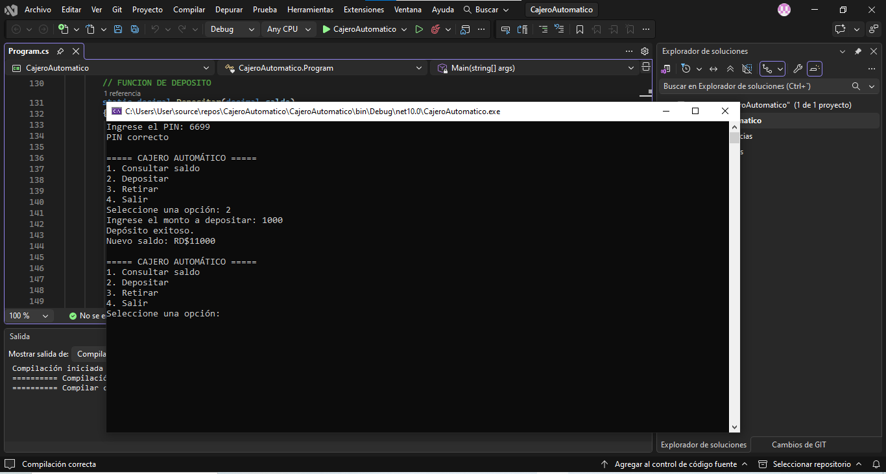
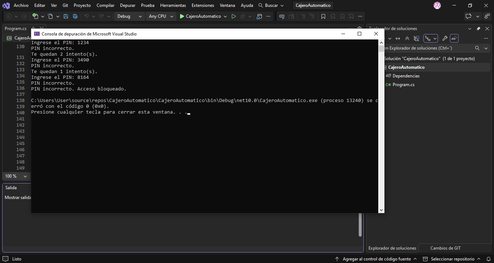

Cajero Automático

1. Autores

- Lucero Esthefani De Jesús - 25-SISN-2-034
- Migue Emanuel Cedano Martínez - 26-EISN-2-027
- Josué Alfredo Trinidad Jiménez - 26-EISN-2-016
- Jumariel Esmeralda Rijo Pascual - 26-EISN-2-017
- Steven Mathei 26-EISN-2-015

2. Descripción del proyecto

Sistema de cajero automático desarrollado en C# como proyecto universitario. Permite consultar el saldo, realizar depósitos y retirar dinero mediante un menú interactivo.

3. Datos de entrada

- PIN de cuatro dígitos.
- Opción seleccionada en el menú.
- Monto que se desea depositar o retirar.

4. Datos procesados

- Validación del PIN con un máximo de tres intentos.
- Verificación de los montos ingresados.
- Comprobación del saldo disponible.
- Actualización del saldo después de cada operación.

5. Datos de salida

- Confirmación o rechazo del acceso.
- Consulta del saldo.
- Confirmación de depósitos y retiros.
- Mensajes de validación y errores.

6. Tecnología utilizada

- Lenguaje: C#
- Entorno de desarrollo: Visual Studio
- Plataforma: .NET 10
  
## Capturas del proyecto

### Depósito exitoso

### Validación de PIN incorrecto

---

# Ejercicio 2: Simulador de Préstamo

## 1. Descripción del proyecto
Aplicación desarrollada en C# que permite simular préstamos, calcular las cuotas mensuales y visualizar una tabla de amortización con el desglose del capital, los intereses y el saldo pendiente.

## 2. Funcionalidades principales
- Ingreso del monto del préstamo.
- Selección de la tasa de interés.
- Definición del plazo de pago.
- Cálculo de la cuota mensual.
- Generación de la tabla de amortización.
- Visualización del total pagado y los intereses acumulados.

## 3. Tecnología utilizada
- Lenguaje: C#
- Entorno de desarrollo: Visual Studio
- Plataforma: .NET

## 4. Código fuente
[Ver proyecto Simulador de Préstamo](./SimuladorPrestamo/)

## 5. Capturas del proyecto

### Categoría A

### Categoría B

### Categoría C

